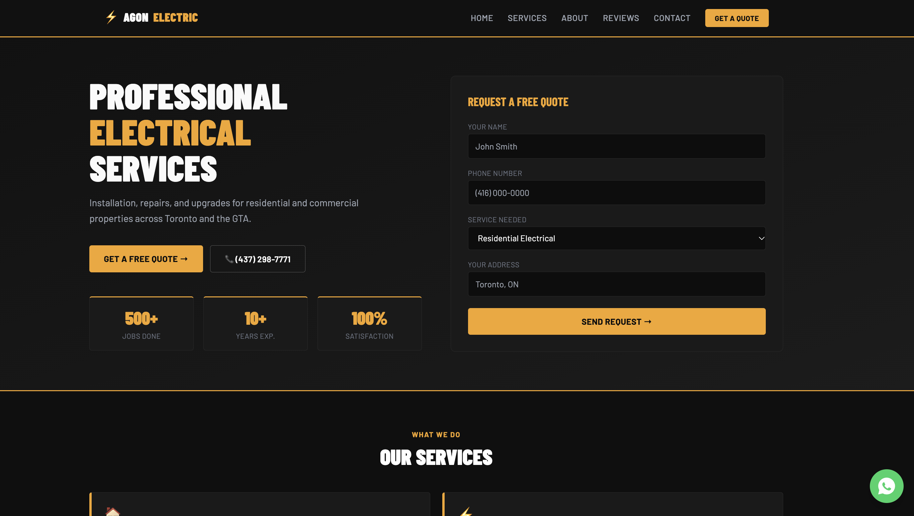
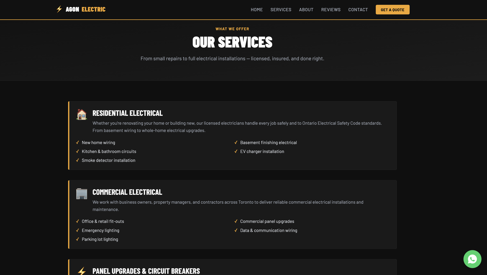
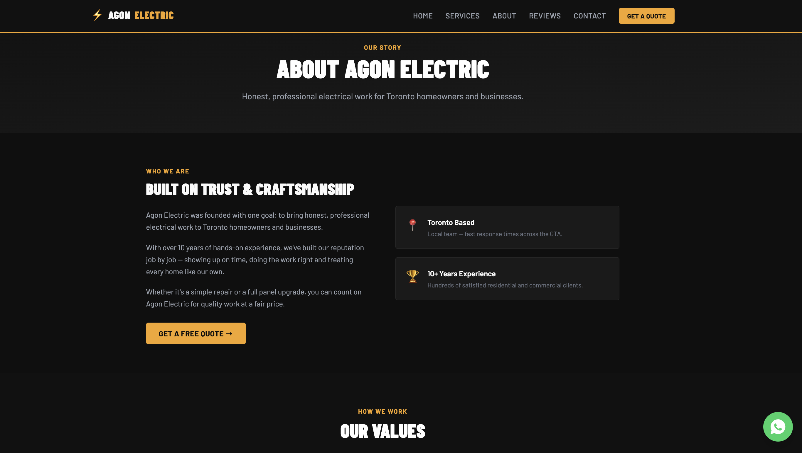
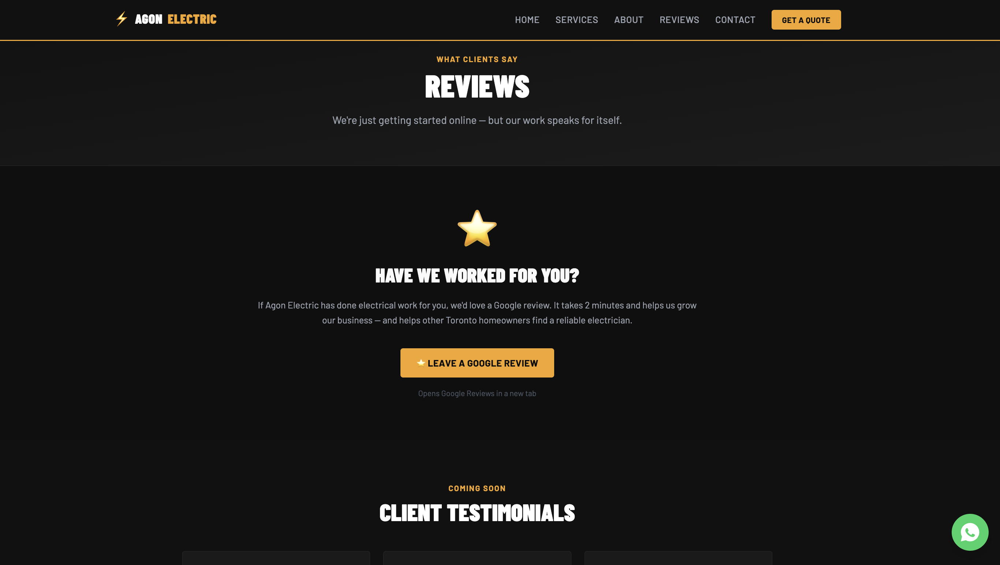
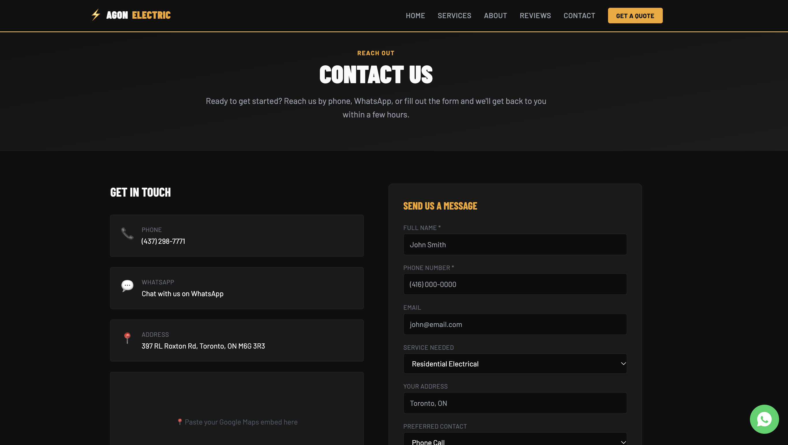

# ⚡ Agon Electric Website

A responsive business website for **Agon Electric**, a Toronto-based electrical company. Designed and built independently with Next.js 14 and Tailwind CSS.

---

## ✨ Features

- **Five pages:** Home, Services, About, Reviews and Contact, built with the Next.js App Router
- **Responsive design:** mobile-first layout styled with Tailwind CSS
- **Reusable components:** sticky navigation bar with a mobile menu, shared footer and a floating WhatsApp contact button, all wired in through a common root layout
- **Contact form:** submissions are handled by a server-side API route (`/api/contact`) that sends email through the [Resend](https://resend.com) API
- **Secure configuration:** API keys are stored in environment variables and kept out of version control

---

## 🛠️ Built With

| Technology | Purpose |
|---|---|
| [Next.js 14](https://nextjs.org/) | React framework (App Router, API routes) |
| [React](https://react.dev/) | UI components |
| [Tailwind CSS](https://tailwindcss.com/) | Styling |
| [Resend](https://resend.com/) | Transactional email for the contact form |

---

## 📁 Project Structure

```
src/
├── app/
│   ├── api/
│   │   └── contact/route.js   # Contact form API route (Resend)
│   ├── layout.js              # Root layout (Navbar + Footer on every page)
│   ├── globals.css            # Global styles + Tailwind
│   ├── page.js                # Home page
│   ├── services/page.js       # Services page
│   ├── about/page.js          # About page
│   ├── reviews/page.js        # Reviews page
│   └── contact/page.js        # Contact page
└── components/
    ├── Navbar.js              # Sticky nav with mobile menu
    ├── Footer.js              # Footer with links and contact details
    └── WhatsAppButton.js      # Floating WhatsApp button
```

---

## 🚀 Running Locally

**Prerequisites:** Node.js 18 or later

1. Clone the repository and install dependencies:
   ```bash
   git clone https://github.com/flor1912/electric-website.git
   cd electric-website
   npm install
   ```

2. Create a `.env.local` file in the project root:
   ```
   RESEND_API_KEY=your_resend_api_key
   ```

3. Start the development server:
   ```bash
   npm run dev
   ```

4. Open [http://localhost:3000](http://localhost:3000) in your browser.

> `.env.local` is listed in `.gitignore` and must never be committed.

---

## 🌐 Deployment

The project is ready to deploy on [Vercel](https://vercel.com), which detects Next.js automatically. Add `RESEND_API_KEY` under **Settings → Environment Variables** before deploying.

---

## 📸 Screenshots







---

## 👩‍💻 Author

Built by **Fluriana Uka** — [GitHub](https://github.com/flor1912) · [LinkedIn](https://www.linkedin.com/in/fluriana-uka)
